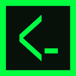

<div align="center">



# Armyx

**An orchestra of AI coding agents on one project: parallel, isolated, and paying only for what changed.**

The desktop app is called **Taurium** (Tauri + React + Rust).


**−91%** cost on the final answer · **−76%** on a review round · **−56%** per worker call · same answers before and after

</div>

---

You wire agents into an *orchestra* on a canvas: a lead briefs the workers, they work in an isolated git worktree, and nothing touches your project until you have read the diff and pressed **Apply**.

## Benchmark: what the orchestra saves

<div align="center">

</div>

Real `claude -p` runs with the exact flags the app passes, Sonnet 5.5 workers, each technique against the same call without it ([`archive/map-bench/orchestra.mjs`](archive/map-bench/orchestra.mjs)):

| Technique | Cost | Agent turns | Wall time | Right answers | n |
|---|---|---|---|---|---|
| **Final answer on Haiku** (the lead's summary goes to the cheap model) | $0.0102 → $0.0009 **−91%** | 1 → 1 | 6.6 → 8.2 s (+23%) | 6/6 → 6/6 | 6 |
| **Review resumes the session** (round 2 continues the worker, nothing resent) | $0.0296 → $0.0072 **−76%** | 4.5 → 2.0 | 17.3 → 9.3 s **−46%** | 6/6 → 6/6 | 6 |
| **Staggered parallel start** (4 calls: one warms the prompt cache, three reuse it) | $0.120 → $0.041 **−66%** | 4 → 4 | 6.6 → 12.2 s (+86%)* | — | 3 |
| **Code slice in the brief** (the worker gets the code it names) | $0.0178 → $0.0079 **−56%** | 2.8 → 1.1 | 10.0 → 6.8 s **−32%** | 30/30 → 30/30 | 30 |
| **Reviewer gets the git diff** (no hunting for what changed) | $0.0215 → $0.0191 −11% | 2.7 → 1.7 | 12.1 → 10.8 s −11% | — | 6 |

\* measured with the old 6 s delay; the app now waits 1.5 s, which kept almost all of the cache saving and answered about 4 s sooner (3 groups of 4 calls). Samples are small (n per row above), so read differences under ~10% as noise. Redraw the chart from your own run with `node archive/map-bench/chart.mjs`.

**And on top of that, the free ones:** a block whose input has not changed reuses its answer (no call, no cost, no wait), and the scanner re-reads only the files that changed: Django (3,408 files) scans in 1.1 s, a rescan after one edit in 0.6–1.0 s, this repo in 0.15 s.

## Features

### ⚡ Speed and the orchestra
- A canvas where a lead agent briefs worker agents along the links you draw, collects their answers and writes one final answer. Claude (Claude Code CLI), Antigravity, DeepSeek, OpenRouter and NVIDIA NIM today, Codex next.
- Blocks run **in parallel** as soon as their inputs are ready (or one at a time if you switch to a queue). The code state is part of the reuse check, so an answer is not reused after the code changed.
- The lead keeps its Claude session between runs (`--resume`), so the dialogue is not sent again; unchanging prompt parts go first so the provider's prompt cache can reuse them; agents are asked for terse answers (fewer output tokens, smaller handoffs).
- A transient API error (overload, rate limit, 5xx, timeout) is retried twice with a pause; a bad key or model fails at once.
- The graph follows your code: a watcher re-scans two seconds after the last change, and the result is identical to a full scan (a test checks that after edits, new files and deletions).
- No per-prompt hooks, no model to download, no background daemon: the app is a plain native binary.

### 🛡️ Safe by default
- Agents run without permission prompts, so each orchestra works in its **own git worktree on its own branch**. *Changes* shows the diff, *Apply* brings it into your project (uncommitted), *Discard* throws it away.
- If a block cannot be isolated (not a git repository, no commit) the run stops with a clear message; it never falls back to working in the real project. You can switch isolation off per orchestra.
- A run stops starting new blocks after $10; a single Claude call is capped at $3. Stop kills the agents and their children.
- API keys live in the OS keychain (Windows Credential Manager, macOS Keychain, Secret Service), not in project folders or exported notes.

### 🧠 Shared project memory
- Open a code folder and the scanner turns it into **notes**, one per file: path, purpose, comments and docstrings, exports, symbols (HTTP routes, Tauri commands, constants), and links between files, including a server route and the Rust or React code behind it.
- You write your own notes next to them (`->@name` links, `?about:` lines, checklists, tags). A rescan never touches what you wrote.
- You browse it as a graph; the lead agent and the chat get it as a compact map of the project.

### 💸 Know what it costs
- Every run posts a table of who spent how many tokens and how much money (new input, cache reads, output, dollars where the CLI reports them); a block that reused its answer is marked as free.
- The sidebar shows your real Claude and Antigravity plan limits.
- Costs are reported only where the provider reports them: Claude gives dollars, DeepSeek and Antigravity give tokens.

## What it is not

It is **not a magic accuracy booster**. We measured that too: a compact map of the project, hooks that feed it to Claude Code, a graph tool server and semantic search did not make an agent more accurate or cheaper on tasks that plain grep already handles (bug fixes, a noisy monorepo, bugs across modules, multi-file questions, 208 fresh pre-registered questions on big repos). All of it was removed. The savings above come from how the orchestra calls the models, not from a smarter agent. The evidence, the scripts and the raw results are in [`archive/map-bench/`](archive/map-bench/README.md).

## Run it

```bash
npm install
npm run tauri dev          # the app
npm test                   # TypeScript tests
cd src-tauri && cargo test # Rust tests
npx tauri build            # installer (unsigned)
```

You need the CLIs of the agents you want to use (`claude`, `agy`) signed in, and `git` for isolation. DeepSeek, OpenRouter, NVIDIA and the Gemini image models take an API key in Settings.

## Known limits

- One worktree per orchestra, so parallel agents inside it share it; it starts from `HEAD`, so uncommitted work in the project is not in it.
- The installer is not signed and there is no auto-update; only Windows has been built and run here, CI covers Linux and macOS but it has not run yet.
- Codex is wired in the backend but disabled in the menu. NVIDIA answers arrive whole, not streamed.
- A rescan still walks the whole folder and compares every note with the one on disk (about 0.4 s and 0.25 s on Django); the remaining time is that, not reading files. The scanner's memory is lost when the app closes, so the first scan after opening is a full one.
- A file edited within the last two seconds is always read again (a coarse file clock could hide the next edit).
