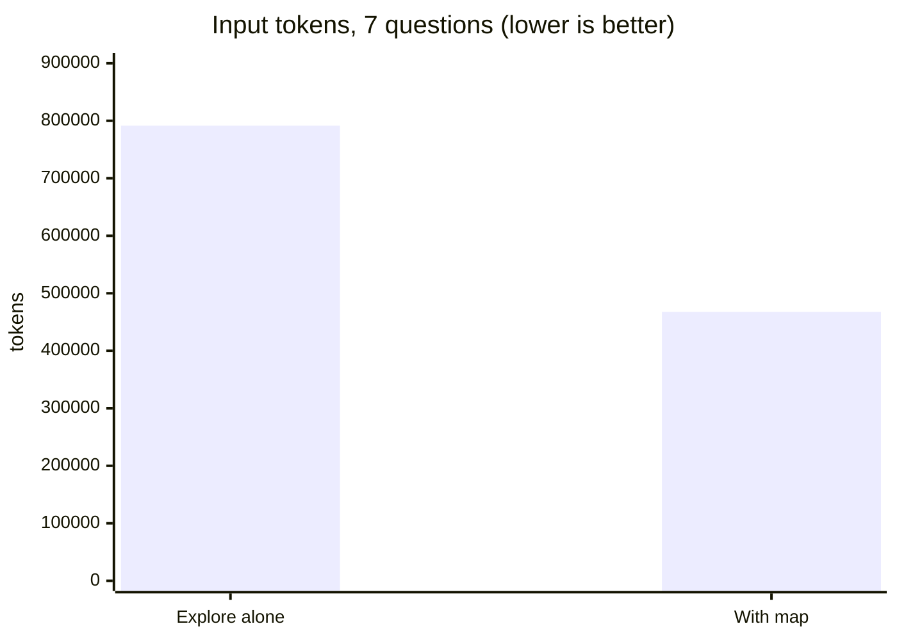
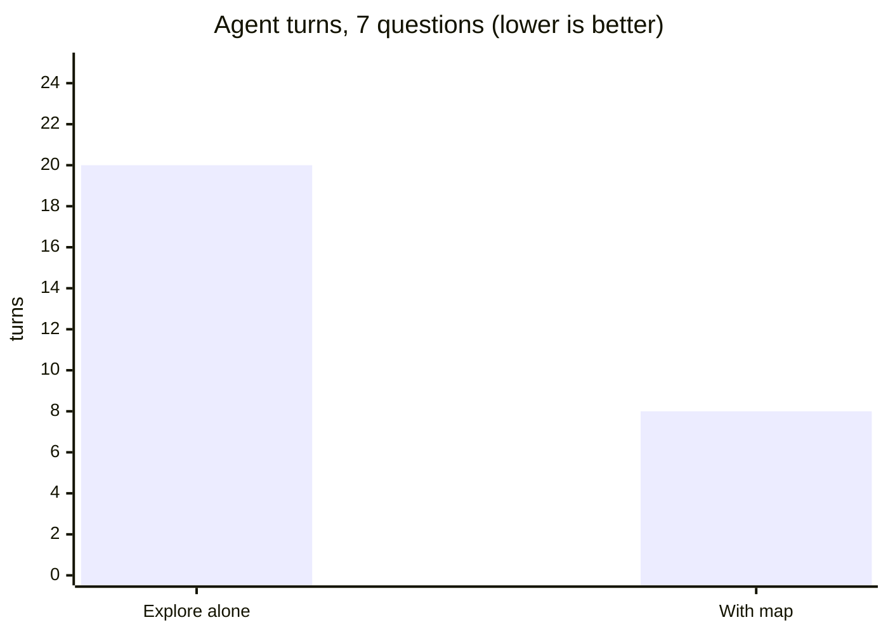
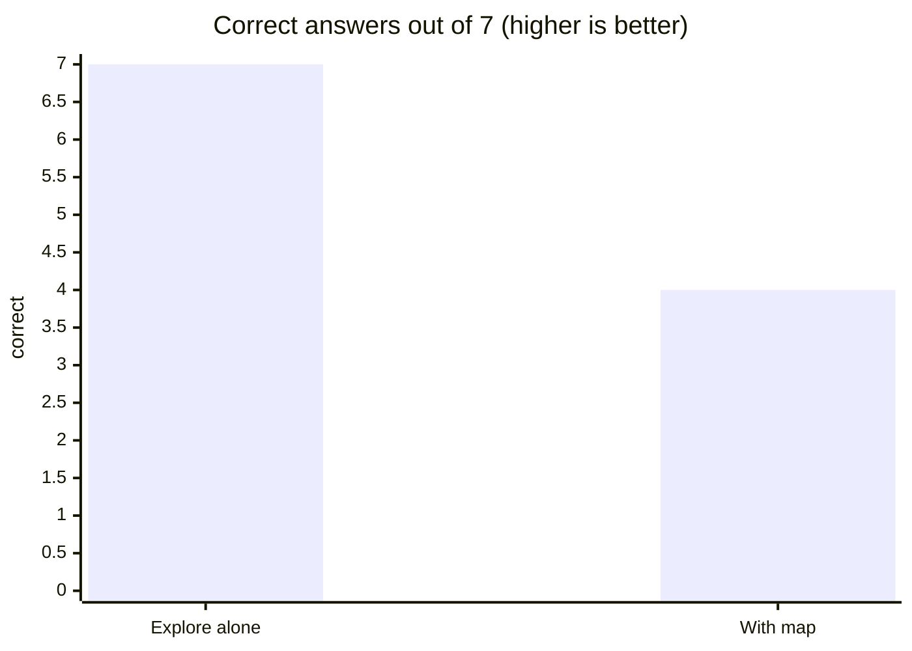

# Armyx

A desktop knowledge graph (Tauri + React) that gives an AI agent a compact **map** of your project instead of the whole codebase. Notes link to each other with `@name`; the map is one line per note, most-connected first.

## Benchmark: NovaFull (production MVP)

Real `claude -p` runs (model `claude-haiku-5-5`), token and cost numbers taken from the API usage report. Same 7 "which file does X?" questions, answered two ways:

- **Explore alone**: the agent searches the project with Read/Grep/Glob.
- **With map**: the Armyx map (10,651 chars, 151 notes) is placed in the prompt.

Project: NovaFull server + launcher + Discord bot, 311 source files (3.5 MB, secrets and build output excluded, no docs).

| | Explore alone | With map | Change |
|---|---|---|---|
| Input tokens | 791,425 | 467,641 | -41% |
| Output tokens | 4,299 | 3,080 | -28% |
| Turns | 20 | 8 | -60% |
| Cost | $0.0393 | $0.0301 | -23% |
| Correct | 7/7 | 4/7 | -3 |

**Honest reading:** the map is much cheaper and faster, but it was less accurate here. In all 3 misses (email sending, launcher updates, bot admin panel) the agent said the map did not name the file, and it guessed instead of opening it. Next step: richer `?about:` lines for those notes and letting the agent open a file when the map is unsure.

Input counts include about 58k tokens of fixed Claude Code overhead per run, so the real saving from the map itself is larger than 41%.

Reproduce: `node bench/bench.mjs <project> <graph dir> bench/questions.novafull.json` (see `bench/bench.mjs`).
