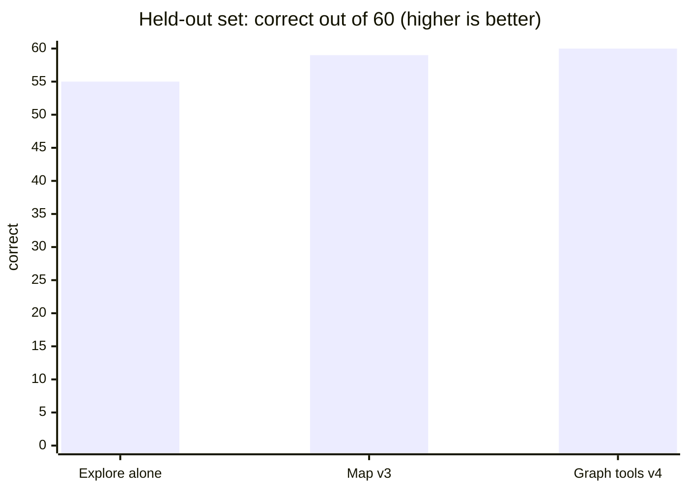
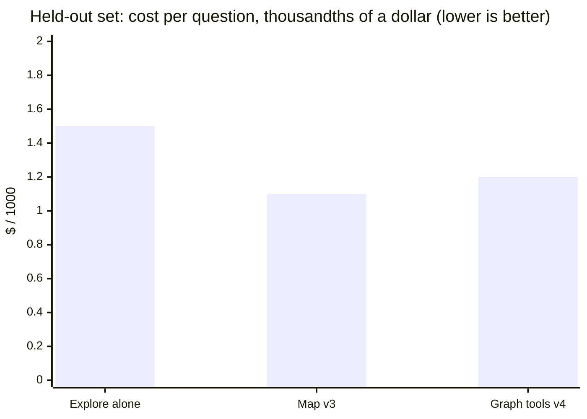
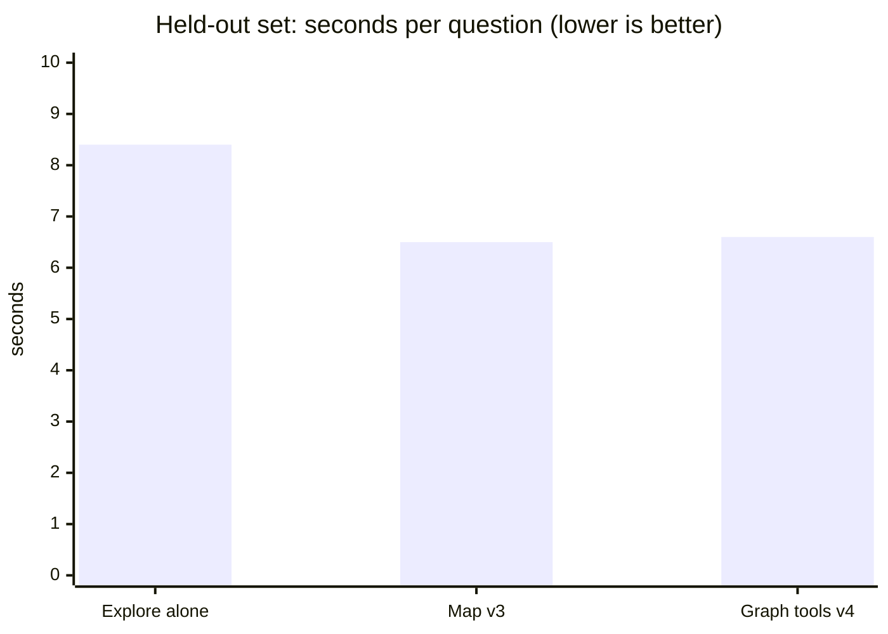

# Archive: the project map as a token and accuracy optimizer

Everything here is research that ended with a negative result and is **not part of the product any more**: the scripts in this folder import code that was removed (the Claude Code hooks, the MCP `find` server, the semantic search, the Rust ranking port; see the git history before the cleanup commit). The raw results (`results*.json`, git-ignored, some of them private) are kept next to them. Delete the whole `archive/` folder when you no longer need the evidence.

What was measured, in the order it was done (copied from the old README; the last two sections are pre-registered and decide the matter):

## Benchmark

Read this first: these are the measurements behind the "what it is not" claim above, kept in the order they were made, so some early passages are more optimistic than the later ones. The last word is in the pre-registered sections near the end (bugs across modules, and *Does the map plus semantic search make the agent more accurate on big repos?*), which found no accuracy or cost case for the map on tasks grep already handles.

Real `claude -p` runs, model `claude-haiku-5-5`; tokens, cost and turns come from the API usage report. All modes have Read/Grep/Glob, the same fixed overhead (no user plugins or MCP servers), and a warmed prompt cache. Every expected file was checked to exist and contain the symbol the question is about.

| Set | What | Questions x repeats |
|---|---|---|
| held-out | "which file does X?" on NovaFull (server + launcher + Discord bot, 248 files), written before the ranking was tuned | 30 x 2 |
| impact | "which files make up feature X across server, launcher and bot?" (answer is a list; ground truth from the project's own flow docs) | 8 x 3 |
| Armyx | the same kind of question on this repo (40 files) | 10 x 2 |
| Django | public repo, 2,943 Python files, 3,408 notes; questions made automatically from random docstrings (`bench/genq.mjs`), no hand-picking | 40 x 1 |

Modes: **alone** (agent explores by itself), **v3** (static map + best matches), **v4** (no map, graph tools through MCP).







| | Explore alone | Map v3 | Graph tools v4 |
|---|---|---|---|
| **Held-out** correct | 55/60 | 59/60 | 60/60 |
| cost per question | $0.0015 | $0.0011 | $0.0012 |
| seconds per question | 8.4 | 6.5 | 6.6 |
| turns per question | 3.5 | 1.3 | 3.0 |
| **Impact** correct (recall) | 24/24 (1.00) | 24/24 (1.00) | 24/24 (1.00) |
| cost per question | $0.0016 | $0.0013 | $0.0016 |
| seconds per question | 9.6 | 8.0 | 7.9 |
| **Armyx** correct | 20/20 | 20/20 | 20/20 |
| cost per question | $0.0011 | $0.0008 | $0.0009 |
| seconds per question | 7.5 | 6.1 | 6.4 |

**Django (12x larger than NovaFull)**

| | Explore alone | Map v3 | Graph tools v4 |
|---|---|---|---|
| Correct | 40/40 | 40/40 | 40/40 |
| median cost per question | $0.0011 | $0.0012 | $0.0010 |
| mean cost per question | $0.0028 | $0.0012 | $0.0011 |
| seconds per question | 15.5 | 7.6 | 6.6 |

The mean for "alone" is pulled up by one run that cost $0.065 (and took over 20 s); the median is the same in all three modes. The map modes never went above $0.002 per question and were about twice as fast. Accuracy does not separate the modes here either: grep finds a docstring by its words, and the model may also know Django. Retrieval alone, no model, found the right file in the top 1 / 3 / 12 only 13 / 19 / 25 of 40 times, because these questions paraphrase a docstring and the index holds names and descriptions, not docstring text. So at this scale the index is a weak guide, and the agent still gets it right by searching.

Retrieval alone, no model, the right file in the top 1 / top 3 / top 12 of the ranking: held-out 22 / 29 / 30 of 30, dev set (the one it was tuned on) 27 / 30 / 30, Armyx 8 / 9 / 10 of 10. Before symbols and BM25 the dev set was 15 / 23 / 28.

**Honest reading**
- The map helps most on cost and time: v3 is about 20-30% cheaper and 17-28% faster than exploring alone, because the agent answers in about 1.3 turns instead of 3.5.
- Accuracy: on the held-out set alone missed 5 of 60, v3 1, v4 none. The gap between v3 and v4 (59 vs 60) is within noise. On the impact and Armyx sets every mode got everything right, so those sets do not separate the modes; an earlier run where alone missed 2 of 24 impact questions was not reproduced under equal conditions.
- v4 is not cheaper than v3: it takes about 3 turns, so the saved tokens go back into extra calls. On Django it was the cheapest and fastest of the three (by a small margin), which fits the idea that tools matter more as the repo grows; one repeat, so no more than that.
- An earlier run of this benchmark showed bigger savings (-38% cost) because it carried about 50k tokens of my own plugin and MCP descriptions per call, which inflated the baseline. The numbers above remove that.
- Amounts are tiny (about a tenth of a cent per question), so these are ratios, not budgets. One model, one main project, a few repeats: differences of one or two questions are noise. Questions are all "find the file(s)"; "explain how X works" is not covered. The scanner's keyword feature (`?keywords`) showed no gain on these questions.
- Dropped after testing: answering without the model when the best hit is clearly ahead (the best hit was right in only 15 of 30 at the time of the test, before the ranking was improved), and capping the agent at one turn (accuracy fell from 29 to 19 of 30).

Reproduce:

```bash
cargo run --example scan -- <project> <graph dir>        # in src-tauri/
node bench/describe.mjs <project> <graph dir>             # one-line purposes and keywords
REPS=2 node --experimental-strip-types bench/bench.mjs <project> <graph dir> <questions.json>
node --experimental-strip-types mcp/graph-server.mjs <graph dir>   # the MCP server
```

### A stronger model: Opus 5.5, effort medium (Armyx set, 10 questions x 2)

The idea: a saved turn is worth more on a pricier model. Same harness, plus mode `hook` (the map and best matches delivered by the Claude Code hooks in `mcp/claude-hook.mjs`, as a user would install them). Paired by question and repeat against exploring alone (20 pairs):

| | Explore alone | Map v3 (system prompt) | Graph tools v4 | Map via hooks |
|---|---|---|---|---|
| Correct | 20/20 | 20/20 | 20/20 | 20/20 |
| turns | 2.10 | 1.40 (-0.70, t -5.5) | 2.05 (-0.05, t -0.4) | 1.65 (-0.45, t -3.9) |
| cost per question | $0.030 | $0.028 (-8%, t -2.1) | $0.030 (no change) | $0.042 (+38%, t 7.6) |
| seconds | 8.2 | 7.0 (t -2.6) | 7.7 | 7.0 (t -2.7) |

- Map v3 repeats its result on a stronger model: fewer turns and about 15% faster, and slightly cheaper.
- Graph tools do nothing on Opus either.
- Hooks keep the turn and time savings but cost more, because Claude Code puts hook output into the first user message, not the system prompt: the ~4.5k-token map is written to the cache again in every new session (usage report, two calls each: 4.2-5.6k tokens of cache writes per call with hooks, 1.8-3.2k with v3, where the map is read from the cache). In this benchmark every question is a new session, which is the worst case; in a long interactive session the map is written once and read afterwards, so the extra cost is per session, not per question. To get the v3 numbers exactly, put the map into the system prompt (`claude --append-system-prompt-file`, the file printed by `claude-hook.mjs <graph> session`).
- Note: the user's own plugin hooks (not MCP servers) were active in every mode of this run; they add the same text to every mode.

### Indexing what the file says (comments and docstrings)

An idea taken from [Graphify](https://github.com/Graphify-Labs/graphify), which turns `# NOTE:` / `# WHY:` comments into nodes: the scanner now stores the docstring first lines (Python) and comment lines of every file, up to 700 characters, in `?doc`, and the ranking counts them with weight 0.5. Retrieval alone, no model, Django (3,408 notes), right file in the top 1 / 3 / 12 of 40:

| | before | with `?doc` |
|---|---|---|
| questions quote the docstring | 18 / 24 / 32 | 30 / 35 / 36 |
| questions rewritten (no shared words) | 2 / 4 / 8 | 4 / 6 / 9 |
| this repo (10) | 9 / 9 / 9 | 9 / 9 / 9 |

Caveat: the quoted questions are made from the same docstrings the index now holds, so that jump is the best case (a user asking in the words of the code). Rewritten questions barely move: words that do not appear in the file can only be matched by embeddings or synonyms, which the scanner does not have. Weights 0.25 to 1 give the same ranking within one or two questions, so there is no knob.

### Deeper graph, no project search, small map (haiku, paired against exploring alone)

The scanner now also links a file to the single other file that defines a function, class or constant it uses (`?calls`, `?callers`), without needing an import; the best matches list those links. New modes: `map-nogrep` (Grep and Glob taken away, only Read, and Edit for bugs; the hook `mcp/claude-hook.mjs <graph> pretool` does the same in Claude Code), `lean` and `lean-nogrep` (a 2.5k-token map instead of 8k).

| This repo, find the file (20 runs per mode, all 20/20 correct) | turns | cost | seconds |
|---|---|---|---|
| explore alone | 2.45 | $0.0011 | 6.3 |
| map v3 | 1.20 (t -7.1) | $0.0009 (t -3.1) | 5.9 |
| lean map | 1.20 (t -6.1) | $0.0009 (t -4.5) | 6.0 |
| map, no Grep/Glob | 1.10 (t -8.1) | $0.0009 (t -1.6) | 5.9 |
| lean map, no Grep/Glob | 1.10 (t -8.1) | $0.0009 (t -1.5) | 5.8 |

| Cross-module bugs (polyglot shop, 8 bugs x 3, all 24/24 fixed) | turns | cost | seconds |
|---|---|---|---|
| explore alone (silently) | 4.42 | $0.0016 | 9.9 |
| map v3 | 3.67 (-0.75, t -2.1) | $0.0014 (t -1.9) | 8.8 (t -2.3) |
| map, no Grep/Glob | 3.63 (-0.79, t -2.2) | $0.0014 (t -1.7) | 9.5 (t -0.8) |

Reading: taking Grep away does not hurt (nothing lost, same savings) and does not help either: it saves no more than the map alone. The small map costs the same as the big one on a 50-file repo. On cross-module bugs the saving is about 0.75 turns and 12% cost; the pre-registered bar (at least 1.0 turn, t <= -2.2) is still not met, and the move from -0.58 to -0.75 turns after adding symbol edges is inside the noise (SE about 0.35), so the deeper graph is not shown to be the cause. Graph build on commit works (`post-commit` hook running `scan`, checked on a throw-away repo); whether notes of deleted files are removed was not checked.

### Where the headroom might be: three checks (haiku)

**1. Per-file keywords from a model on rewritten questions.** The earlier "no gain" came from easy questions, so this was repeated on the rewritten Django set with a model-written `?keywords` line for every file. To keep it fair and affordable the corpus is 500 files (the 40 targets plus 460 random ones), not 3,408. Retrieval alone, right file in the top 1 / 3 / 12 of 40: without keywords 5 / 8 / 13, with them (weight 0.3) 4 / 6 / 13, weight 1: 3 / 7 / 13. **No gain.** The sought thing is one function's docstring inside a big file, and a per-file keyword list does not describe that function. Per-function descriptions (about five model calls per file) or embeddings would be the next thing to try; neither was.

**2. Cost tail, Django rewritten questions, 120 runs per mode** (3 repeats of 40):

| | explore alone | map v3 |
|---|---|---|
| correct | 107 | 114 |
| mean / median cost | $0.0023 / $0.0018 | $0.0025 / $0.0021 |
| p95 / max | $0.0050 / $0.0095 | $0.0053 / $0.0099 |
| turns | 4.86 | 4.78 |

No tail showed up: the $0.065 run seen earlier on Django did not repeat in 240 runs, and the map is not cheaper at any percentile (paired +$0.0002, t 1.5). Its one difference is accuracy: it solved 10 pairs that exploring alone missed and missed 3 that alone solved (7 more correct of 120; sign test p about 0.09, so a hint, not a result).

**3. Questions that need several files** (`bench/genrefs.mjs`: "which files use function X", answer from plain text matching of the word, not from the graph; 20 questions with 3-8 files each, 2 repeats). Grep is the right tool for this and the map did not beat it: correct 36/40 alone against 34/40 with the map, precision 0.73 for both, cost $0.0014 against $0.0017 (paired +$0.0003, t 4.9), turns 2.42 against 2.70. The `?callers` list shown for the best match did not help; the graph costs a little here and gains nothing. Not tested: refactors and "explain how X works", which need a judge, not a text-matching ground truth.

Summary of the three: nothing found that makes the map pay on a task that grep handles. The one open lead is accuracy on hard rewritten questions (7 more correct of 120), which needs more runs.

### Sizing the map to the project (`mapFor`)

Up to 300 files the map is 2.5k tokens (it gave the same result as 8k); beyond that only a folder outline and the best matches are sent. Modes: `auto` (this), `hits` (no map at all, best matches only), against exploring alone and the old 8k map; haiku, 2 repeats, paired:

| | `auto` | old map v3 | `hits` |
|---|---|---|---|
| this repo, find the file (20 runs): cost | **-17%** (t -3.4) | -4% | |
| turns | -50% | -50% | |
| Django, quoted (80 runs): cost | +10% (t 6.6) | +25% | +10% |
| Django, rewritten (80 runs): cost | +10% (t 1.2) | +4% | +17% |
| Django, rewritten: correct of 80 (alone 71) | 74 | 71 | 77 |

So the small map is the saving on small projects (-17% cost, half the turns). On a 3,400-file project nothing we tried gets below plain search: dropping the 8k map cut the extra cost from +25% to +10%, no more. On the hard rewritten questions the best matches alone solved 6 more of 80 than exploring (consistent with the +7 of 120 earlier) at 10-17% higher cost: the only place the graph buys something, and it is accuracy, not tokens. One model, 2 repeats: treat the accuracy numbers as a hint.

### Doing no harm on big projects (`safe`, the default of the hook)

Small project: lean map and best matches. Big project (over 300 files): no map, and best matches only when the best hit scores at least 1.5x the second (`sureHits`); otherwise the agent gets exactly what it gets without us. Haiku, 2 repeats, paired against exploring alone:

| | cost | turns | time | correct |
|---|---|---|---|---|
| this repo, find the file (20 runs) | **-31%** (t -7.7) | -57% | -8% | 20 -> 20 |
| Django, quoted (80 runs) | +1% (t 0.6) | +1% | +4% | 80 -> 80 |
| Django, rewritten (80 runs) | -1% (t -0.1) | -4% | -3% | 73 -> 72 |

On the big project the cost is the same as without the graph (nothing measurable lost, nothing gained), against +10% to +25% with the maps before. The price is that the extra accuracy the best matches gave on hard questions is gone too: the sure-gate stays silent on most of them. The 1.5 threshold was chosen on the same Django questions it is tested on, so it may be tuned to them; check it on your own project. One model, 2 repeats.

## Bug-fix benchmark

`bench/edit.mjs` injects a real bug into a throw-away copy of a project, gives the agent only a plain-language symptom (no file, no function name) with Read/Grep/Glob/Edit, and lets the project's own tests decide. Tasks are checked first: the tests must pass on the original code and fail on the broken one (tasks that fail that check are dropped, which removed 4 of 9 on NovaFull because its own selftests do not cover those behaviours). 9 bugs on this repo, 5 on NovaFull, 2-3 repeats, same conditions for every mode.

| | Explore alone | Map v3 | Graph tools v4 |
|---|---|---|---|
| **Armyx** fixed (27 runs per mode, 9 bugs x 3) | 27/27 | 27/27 | 18/18 (2 repeats) |
| turns per task | 5.6 | 4.6 | 6.3 |
| cost per task | $0.0027 | $0.0023 | $0.0025 |
| **NovaFull** fixed (10 runs per mode) | 10/10 | 10/10 | 10/10 |
| turns per task | 5.5 | 4.6 | 7.3 |
| cost per task | $0.0036 | $0.0035 | $0.0032 |
| seconds per task | 15.0 | 13.6 | 17.4 |

Every mode fixes nearly everything, so accuracy does not separate them. What the map changes is the number of turns: about one fewer per bug (it saves the search, but the agent still has to read the file and edit it), against about two fewer when the question is only "which file". Graph tools (v4) take more turns than the map on these small projects.

Telling the agent to "work silently, read only the suspect file, edit, answer in one line" (Armyx, 27 runs per mode): without a map it cut output tokens by 22% but failed 2 of 27 (both on the same bug: the agent skipped exploring and gave up after 9 turns); with the map it was safe, 27/27, 3.9 turns, $0.0022. Treat that as a hint, not a result: 27 runs, one project.

Hypothesis from these runs: after the map removes the search, the floor is a read-edit-answer loop of about four turns. I tested the obvious ways to cut it (an idea from asking several models, prompt in `bench/orchestra-prompt.md`): put the code the agent will edit (file head plus the matching function, `src/slice.ts`) into the first message, and give it a `patch(path, old, new)` tool that needs no separate read (opt-in in `mcp/graph-server.mjs`, only active when `ARMYX_ROOT` is set). Result, 27 runs per mode on this repo, all with the map and the "work silently" line: baseline 4.6 turns, 26/27 fixed; with the slice 3.8 turns, 27/27; with slice plus patch 3.9 turns, 27/27, cost $0.0022 / $0.0023 / $0.0024. On NovaFull (8 runs per mode) 4.1 / 4.4 / 4.0 turns. Compare modes only inside one batch: the same baseline gave 3.9 turns in an earlier batch and 4.6 in this one, so numbers from different batches cannot be compared. Inside the batch, paired by task and repeat, the slice saves 0.74 turns (SE 0.24) and slice plus patch 0.70 (SE 0.27) on this repo, but cost and time do not change measurably (cost +$0.0001, SE $0.0001; time about -1 s, SE about 1 s), and on NovaFull, with only 8 pairs, nothing can be said. So: a real but small cut in turns that does not show up in money or time, because each extra turn is cheap when the context is cached. The agent still takes close to four turns.

### Scale: Django (2,943 files) and Home Assistant (15,553 files)

Questions are generated from random docstrings (`bench/genq.mjs`), 40 per repo, one run per mode. Two versions: the docstring quoted word for word, and rewritten by a model (`bench/paraphrase.mjs`) so that no word of 5+ letters and no item name is shared, which is how a person would ask and what grep cannot match.

| 40 questions per cell | Explore alone | Map v3 | Graph tools v4 |
|---|---|---|---|
| Home Assistant, quoted: correct | 40 | 40 | 40 |
| turns / cost / seconds | 2.1 / $0.0016 / 7.7 | 2.05 / $0.0019 / 9.1 | 2.25 / $0.0016 / 8.2 |
| Home Assistant, rewritten: correct | 25 | 25 | 28 |
| turns / cost / seconds | 11.2 / $0.0075 / 37.5 | 9.3 / $0.0064 / 30.0 | 12.4 / $0.0075 / 37.9 |
| Django, rewritten: correct | 35 | 34 | 37 |
| turns / cost / seconds | 5.8 / $0.0029 / 18.4 | 5.9 / $0.0032 / 18.6 | 6.2 / $0.0029 / 17.9 |
| both repos, rewritten: correct of 80 | 60 | 59 | 65 |

Read it carefully:
- With quoted docstrings grep wins, and the map costs more and is slower (paired, Home Assistant: +$0.0002 and +1.4 s, both clearly above noise).
- Rewriting the questions is what makes the task hard: Home Assistant accuracy falls from 100% to 63-70%, and cost and turns grow four to five times.
- On rewritten questions the modes cannot be told apart reliably. The map saves 7.5 s on Home Assistant (t = -2.3) but not on Django. Graph tools got 5 more answers right out of 80 (10 questions only they solved, 5 only grep solved, sign test p about 0.3), which is a hint at best. One run per question: a difference of a few questions is noise.
- Some limits showed up at this scale: with the app's default cap of 5,000 notes only 23 of the 40 target files are in the graph (the command line scan takes `ARMYX_MAX_NODES` to lift it; the full Home Assistant graph is 16,499 notes and scans in 32 s); the static map holds 157 lines, about 1% of the files, so at this size only the best-match block and the tools do the work; one search over 16.5k notes takes about 0.6 s because the index is rebuilt on every call.

### A noisy monorepo (62 services, same function names everywhere)

`bench/gen-monorepo.mjs` writes a repo of 62 small services that all define `handleEvent` and `processItem`, share three helper libraries and one routing table (193 files, 328 tests, no dependencies). `bench/edit-tasks.noisy.json` has 8 injected bugs: in one service's config or logic, in a shared helper (the symptom shows up in dozens of services), and in the routing table. The idea, from one of the models I asked for hypotheses: grep drowns when every service has the same function names, a graph should not. 24 runs per mode, 3 repeats:

| | Explore alone | Alone + "silently" | Map v3 + "silently" | Graph tools v4 |
|---|---|---|---|---|
| Fixed | 23/24 | 23/24 | 23/24 | 24/24 |
| turns per task | 5.9 | 5.4 | 4.8 | 7.2 |
| cost per task | $0.0027 | $0.0023 | $0.0028 | $0.0030 |
| seconds per task | 15.9 | 14.0 | 14.5 | 16.0 |

Paired by task and repeat: the map saves 1.08 turns against plain exploring (SE 0.30) but only 0.58 against exploring with the same "silently" line (SE 0.31) and it costs $0.0005 more per task than that (SE $0.0002); graph tools take 1.3 more turns than exploring and 2.4 more than the map. Grep did not drown: bug reports use business words (shipping, refund), which are unique per service even when the function names are not, and the shared-library bugs are found by following the one helper every service imports.

The orchestra proposed a stop rule for the map on bug-fixing: stop if the success gap is under 10%, if the turns saved are within noise, or if cost per fixed bug is higher with the map. On this benchmark all three hold against the "silently" baseline. That says nothing about the find-the-file questions above, where the map was clearly cheaper and faster, nor about bugs that need many files, which I did not test.

What the agent actually does (27 traced runs on this repo, tool calls per run): exploring alone 4.1 (Grep 1.7, Read 1.1, Glob 0.3, Edit 1.0); with the map 3.1 (Grep 1.2, Read 0.9, Edit 1.0). Even when the map names the right file, the agent still runs one Grep to check. The best match is not usually first for a bug report: on this repo the right file was first in 2 of 9, in the top 3 in 5 of 9, in the top 12 in all 9, because bug reports do not use the words of the code.

Taking `Grep` and `Glob` away from the agent when the search is "confident" (best hit at least 1.25 times the second), an idea from the same models, did nothing (this repo, 18 runs per mode, paired): 18/18 fixed either way, 3.9 turns either way (difference -0.06, SE 0.36), cost $0.0004 higher (SE $0.0002). The confidence signal is poor: 6 of the 10 "confident" runs had the wrong best hit, and all 6 were still fixed, because the map in the prompt lists every file and the agent simply reads the right path. The turn count does not depend on the tools; it is a fixed rhythm of short note, read, edit, short note.

### Bugs that cross modules and languages (pre-registered)

The main idea of the graph is that it links things text search does not: a Python command-line client and a web client meet the Node server only at an HTTP route string, and every feature meets the others in one shared money library. `bench/gen-polyglot.mjs` builds such a shop (10 features, server + Python CLI + web client, 20 integration tests that start the server and call both clients). `bench/edit-tasks.polyglot.json` has 8 bugs whose symptom is written the way a user would (no file or function names): a renamed response field, a wrong tax rate or rounding in the shared library, a crash in the CLI client, a typo in a web path, a flipped discount comparison, a wrong count, a typo in a route. The graph has the cross-language links (client file -> route file -> rules file).

The hypothesis, the rule for calling it supported or refuted, and my own expectation were written down before any run (`bench/preregistration-crossmodule.md`). 3 repeats per bug and mode, paired by bug and repeat, baseline "explore with the silently line":

| | Explore alone (silently) | Map v3 (silently) | Graph tools v4 |
|---|---|---|---|
| Fixed | 24/24 | 24/24 | 24/24 |
| turns per bug | 4.17 | 3.58 | 7.42 |
| cost per fixed bug | $0.0016 | $0.0014 | $0.0020 |
| seconds | 9.9 | 9.0 | 12.4 |
| paired vs baseline: turns | | -0.58 (SE 0.29, t -2.0) | +3.25 (SE 0.57, t 5.7) |
| paired vs baseline: cost | | -$0.0001 (t -1.9) | +$0.0005 (t 4.1) |

Verdict by the pre-registered rule (supported needed at least 1.0 fewer turns with t <= -2.2 and no higher cost per fix): **not supported**. The map is inconclusive: a small saving (about 0.6 turns, 12% of cost, 9% of time) that does not reach the bar. Graph tools are refuted: 3.25 more turns and 31% more cost. In the traces the agent used `find` in all 24 graph-tool runs but `neighbors` in 3 and `impact` in none, so the graph edges that were the point of the test were hardly used; the tool served as a search box and the agent then read about 2.7 files per bug. With the map in the prompt it almost stopped grepping (0.1 Grep calls per bug against 1.3) and read the right files at once. I expected a 20-30% chance of support, and the result is on the unlucky side for the tools. One model (haiku), one generated project, 24 pairs: a small effect could still be hiding under the noise.

Follow-up, also pre-registered: I rewrote the instruction so that the agent calls `find`, then `impact` on the best file, then reads only what it lists, and does not use grep (mode `map-v4-nudge`). It did call `impact` in 24 of 24 runs, and it made things worse: 3.21 more turns than exploring alone in the same batch (t 7.6), $0.0004 more per bug, 3.1 s slower; all modes still fixed 24 of 24. `impact` lists the whole chain (client, route, rules, shared library) and the agent reads all of it, about 3.2 files per bug, where exploring alone reads under one. So on this stand the graph tools do not beat plain search, with or without being told to use the links.

### Semantic search (beta, opt-in)

Settings → *Semantic search* downloads a small local model (bge-small-en-v1.5, quantized, 34 MB, ONNX on the CPU, `src-tauri/src/embed.rs`), embeds every note once (vectors in `<graph>/embeddings.bin`, rebuilt only for notes whose text changed) and fuses its ranking with the word match (reciprocal rank fusion, meaning weighted 0.25, `rank.rs`). Off by default: it adds about 0.2 to 0.3 s per prompt in the hook (model load), the app grows by about 28 MB, and the gain is modest.

Measured offline, no API calls (`cargo run --release --example rankeval -- <graph> <questions.json> --semantic`), share of expected files in the top k, words only → hybrid:

| Set (questions) | @1 | @3 | @5 | @12 |
|---|---|---|---|---|
| Django, plain (40) | 0.55 → 0.55 | 0.70 → 0.73 | 0.70 → 0.80 | 0.85 → 0.90 |
| Django, reworded docstrings (40) | 0.05 → 0.08 | 0.05 → 0.10 | 0.08 → 0.10 | 0.13 → 0.15 |
| This repo, plain (10) | 0.70 → 0.80 | 0.90 → 0.90 | 0.90 → 0.90 | 0.90 → 0.90 |
| This repo, reworded (16, written by the code's author) | 0.56 → 0.50 | 0.63 → 0.63 | 0.63 → 0.69 | 0.75 → 0.81 |
| All 106 | 40 → 41 | 49 → 52 | 50 → 56 | 60 → 64 |

(All 106: files found, out of 106.) The weight 0.25 was picked from four values (1.0, 0.6, 0.4, 0.25) on these same sets, so the table is a little optimistic. With equal weights the plain Django questions got worse (top 12: 0.85 → 0.75): the model pushed right answers out. On Django the graph has 3,408 notes; indexing took 6.5 minutes on this laptop's CPU (once; later only changed notes), the vectors are 5.4 MB, and the hook takes 0.57 s with the model against 0.29 s without.

What it does not do: the model is English-only (5 Russian questions on this repo found nothing, with or without it); the reworded Django questions stay almost unsolved by either (`questions.django.para.json` rewrites the very words the index holds); and the "positions of graph nodes" miss (`layout.ts`) stays.

### Does the map plus semantic search make the agent more accurate on big repos? (pre-registered: no)

`bench/preregistration-hybrid.md` fixed the hypothesis and the stop rule before the run. 208 fresh reworded questions (58 Django, 150 Python standard library, none used to tune anything), haiku, the real hook (`deso-vault --armyx-hook`), one run per question:

| | explore alone | hook, words only | hook, words + meaning |
|---|---|---|---|
| correct | 170/208 | 168/208 | 166/208 |
| cost per correct answer | $0.0040 | $0.0040 | $0.0038 |
| turns / seconds | 6.47 / 19.1 | 6.44 / 19.2 | 6.18 / 18.5 |

Paired, the hook changes accuracy by -1.0 point (p = 0.83) and the hybrid by -1.9 points against exploring alone (p = 0.54; about 95% interval -6.5 to +2.7). The rule needed +8 points: **not supported**. A gain above about +3 points is ruled out at this size. On "find the file" questions a modern agent with grep is already right 82% of the time and the extra hints neither help nor hurt measurably; the cost per correct answer is within noise too. Together with the bug-fix, noisy-monorepo, cross-module and multi-file results above, the case for the map is not accuracy or tokens on tasks grep handles.

